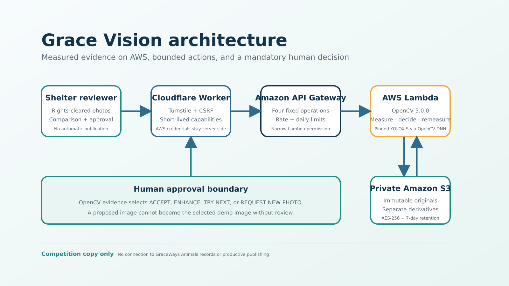

# Architecture

## Runtime flow

1. The reviewer selects one to five rights-cleared JPEG/PNG images, confirms rights and completes Turnstile.
2. The Cloudflare Worker verifies origin, CSRF state, short-lived session/job capabilities, request shape and daily limits. It keeps the Gateway key and AWS details server-side.
3. API Gateway accepts only the fixed create, analyze, result and decide operations and invokes the existing Lambda through a narrowly scoped resource permission.
4. Lambda writes original bytes to a private S3 prefix with a recorded SHA-256, then OpenCV 5.0.0 measures quality and OpenCV DNN supplies cat-framing evidence.
5. The deterministic policy selects `ACCEPT_ORIGINAL`, `ENHANCE`, `TRY_NEXT_IMAGE` or `REQUEST_NEW_PHOTO`.
6. For `ENHANCE`, a separate derivative is created by bounded operations and remeasured from the exact stored bytes.
7. The browser receives short-lived previews, measurements, reasons and a decision trace. Nothing changes until the reviewer explicitly approves or requests a new photo.

## Trust boundaries

| Boundary | Controls |
| --- | --- |
| Browser to Worker | Turnstile, same-origin/CSRF checks, secure session cookie, rights assertion, input limits |
| Worker to Gateway | Server-held API key, fixed protocol, short-lived job token, rate/daily limits |
| Gateway to Lambda | Fixed method/path and resource-scoped Lambda permission |
| Lambda to S3 | Prefix-scoped get/put only; no delete permission; TLS-required bucket policy |
| S3 | Private, ACLs disabled, public access blocked, AES-256, seven-day prefix lifecycle |
| Human decision | Proposal visible before approval; approval does not publish to GraceWays Animals |

## Data model

Originals, derivatives, traces and approvals live in different S3 prefixes. The original object is never overwritten. A derivative has its own SHA-256. The final decision record has `published=false`; there is no production publishing API in this competition system.

## Separation from GraceWays Animals

The jury Worker has no production route, database binding or media bucket binding. The competition stack is additive and isolated. Integration into the productive application is future work requiring a separate authentication, authorization and data-protection review.

